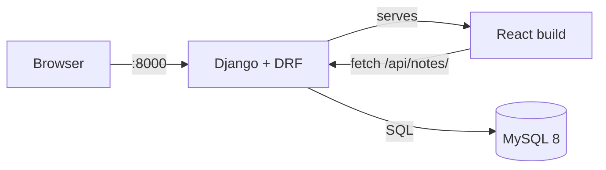

# Django Notes App

A small notes application: a Django REST Framework API with a React frontend. In the Docker setup Django also serves the built React app, so the whole stack runs behind a single port.

Forked from [LondheShubham153/django-notes-app](https://github.com/LondheShubham153/django-notes-app).

## Stack

| Layer | Technology |
| --- | --- |
| Backend | Django 4.1, Django REST Framework, Gunicorn |
| Frontend | React 18 (Create React App) |
| Database | MySQL 8 |
| Static files | WhiteNoise |
| Container | Docker, Docker Compose |
| Reverse proxy (optional) | Nginx |
| CI (optional) | Jenkins |

## Architecture



Requests to `/api/notes/` are handled by DRF and stored in MySQL. The React build in `mynotes/build` is rendered by Django at `/`, and its JavaScript calls the API on the same origin.

During local development the React dev server runs on port 3000 and proxies `/api` requests to Django on port 8000, as configured by the `proxy` field in `mynotes/package.json`.

## API

Base URL: `http://localhost:8000/api`

| Method | Endpoint | Description |
| --- | --- | --- |
| GET | `/` | List of available routes |
| GET | `/notes/` | All notes |
| GET | `/notes/<id>/` | Single note |
| POST | `/notes/create/` | Create a note (`{"body": "..."}`) |
| PUT | `/notes/<id>/update/` | Update a note (`{"body": "..."}`) |
| DELETE | `/notes/<id>/delete/` | Delete a note |

A note has `id`, `body`, `created`, and `updated` fields. The admin interface is at `/admin/`.

## Setup

### Prerequisites

- Docker with Docker Compose

### Docker (recommended)

```bash
git clone https://github.com/Mujakkir-Pathan/django-notes-app.git
cd django-notes-app
cp .env.example .env
docker compose up --build
```

Open http://localhost:8000. On first start the migrations run automatically against the MySQL container.

Useful commands:

```bash
docker compose logs -f web
docker compose exec web python3 manage.py createsuperuser
docker compose down       # stop
docker compose down -v    # stop and delete the database volume
```

### Local development

Backend and frontend run as separate processes.

Terminal 1, backend (requires running MySQL and the values from `.env`):

```bash
python3 -m venv .venv
source .venv/bin/activate
pip install -r requirements.txt
pip install mysqlclient
set -a; source .env; set +a
python3 manage.py migrate
python3 manage.py runserver 8000
```

`mysqlclient` needs the MySQL client development libraries, for example `default-libmysqlclient-dev` on Debian/Ubuntu.

Terminal 2, frontend:

```bash
cd mynotes
npm ci
npm run build     # one time: Django reads files from mynotes/build
npm start         # dev server on http://localhost:3000
```

`npm start` proxies API calls to `http://127.0.0.1:8000`, so use http://localhost:3000 while developing.

### Tests

```bash
python3 manage.py test
```

## Configuration

Django reads the database settings from environment variables. The compose file loads them from `.env`, which is created from `.env.example`.

| Variable | Description | Example |
| --- | --- | --- |
| `DB_NAME` | Database name | `notes_db` |
| `DB_USER` | Database user | `root` |
| `DB_PASSWORD` | Database password | `root` |
| `DB_HOST` | Database host | `db` (compose service name) |
| `DB_PORT` | Database port | `3306` |

For manual runs export them first: `set -a; source .env; set +a`.

The project ships with `DEBUG = True` and `ALLOWED_HOSTS = ['*']`, which is fine for local use. For a real deployment set `DEBUG = False`, restrict `ALLOWED_HOSTS`, and serve with Gunicorn (`Procfile` contains the entry point).

## Project structure

```
django-notes-app/
├── Dockerfile              # multi-stage: React build, then Python image
├── docker-compose.yml      # web and MySQL services
├── .env.example            # database settings template
├── Jenkinsfile             # Jenkins pipeline: clone, build, push, deploy
├── Procfile                # gunicorn entry point for PaaS deploys
├── manage.py
├── notesapp/               # Django project: settings, urls, wsgi
├── api/                    # DRF app: models, serializers, views, urls
├── mynotes/                # React app
│   ├── src/
│   ├── public/
│   └── build/              # created by npm run build, not committed
├── nginx/                  # optional reverse proxy config
├── requirements.txt
└── staticfiles/            # created by collectstatic, not committed
```

## Nginx (optional)

`nginx/` contains an image and config that reverse proxy port 80 to the Django container (`django_app:8000` on the Docker network). Build it with `docker build -t notes-nginx nginx/` and run it on the same network as the app.

## Jenkins (optional)

`Jenkinsfile` defines the community Jenkins pipeline: clone the repository, build the Docker image, push it to Docker Hub, and deploy.

## Author

Original project by [LondheShubham153](https://github.com/LondheShubham153) for the TWS Community.
